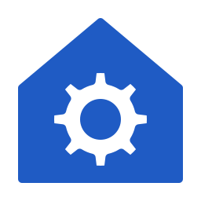

<p align="center">
  
</p>

<h1 align="center">RustHome</h1>

<p align="center">
Domotique maison en <strong>Rust</strong> et <strong>Svelte 5</strong>, pensée pour remplacer progressivement Home Assistant sur une installation réelle.
</p>

---

## Où en est le projet

| Jalon | Contenu | État |
|---|---|---|
| **M1** : cœur | Modèle, registres (pièces, appareils, entités), états, historique SQLite, API REST + WebSocket, connexion Authelia (OIDC), miroir de Home Assistant en lecture seule, interface de consultation | ✅ |
| **M2** : intégrations natives | Zigbee2MQTT, Philips Hue, Portainer, Frigate. Les `entity_id` de HA sont repris à l'identique | ✅ (HomeKit reporté) |
| **M3** : automatisations | Import des automatisations HA (blueprints compris, `device_id` traduits), moteur (déclencheurs, conditions, actions, modes), traces, éditeur YAML | ✅ |
| **M4** : dashboards et interface | Import Lovelace (Mushroom, Bubble, tempometer, Emby, agendas, Spotify… convertis en cartes natives, aucune carte non supportée sur les tableaux réels), éditeur façon HA (vues, sections, grille 12 colonnes, glisser-déposer, formulaires par carte et sous-cartes, sélecteur d'icônes, YAML), tableau par défaut ouvert à l'accueil, onglets réduits à l'icône, mode kiosque, menu latéral (tableaux, Vue d'ensemble, Énergie, Carte, Journal, Historique, Média, Alarme, ESPHome, Zigbee2MQTT), Paramètres et profil, thème clair/sombre avec interrupteurs et curseurs façon HA, météo avec prévisions, commande des lumières (couleur, blanc, luminosité), navigateur média (caméras, clips, instantanés et enregistrements Frigate lus en HLS, médias de HA) | ✅ |
| **M5** : éditeur visuel et Zigbee | Éditeur visuel des automatisations (blocs imbriqués, synchronisé avec le YAML) ; gestion Zigbee2MQTT : appairage, renommage avec propagation des entity_id, mises à jour OTA, groupes, liaisons | ✅ (carte du réseau à venir) |
| M6 à M9 | ESPHome, HomeKit, alarme, autres intégrations | à venir |

Le détail est dans [docs/architecture.md](docs/architecture.md) (§13 pour les jalons, §9 pour les phases de migration) et dans [docs/integrations.md](docs/integrations.md).

## Principes

- **Migration progressive.** RustHome tourne à côté de Home Assistant. Il lit d'abord HA, puis reprend les sources une à une, en conservant les mêmes `entity_id`. Les automatisations et dashboards existants restent ainsi valides.
- **Lecture seule par défaut.** Pendant le développement, RustHome ne commande aucun appareil réel : MQTT et Hue sont en lecture seule, Portainer ne sait faire que des GET, et le pont HA ne peut pas appeler de service. Chaque bascule se fait explicitement, phase par phase.
- **Dashboards importés à l'identique.** Les dashboards HA sont repris avec leurs vues et leurs cartes ; une carte sans équivalent reste visible comme « non supportée », sa configuration d'origine est conservée.
- **Automatisations importées désactivées.** Les automatisations reprises de HA arrivent désactivées et s'activent une par une. Même activées, elles ne peuvent rien piloter tant que les intégrations restent en lecture seule.
- **Une seule source par entité.** Une entité reprise par une intégration native n'est plus écrasée par le miroir HA.
- **Qualité.** Tests unitaires obligatoires, `clippy` en mode strict, types TypeScript générés depuis Rust. `just check` doit passer avant tout commit.

## Architecture

```
crates/
  rusthome-model      types du domaine (EntityId, State, registres) + JSON Schema
  rusthome-core       bus d'événements, state machine, registres, services
  rusthome-recorder   persistance SQLite (registres, historique)
  rusthome-template   Jinja façon Home Assistant (minijinja)
  rusthome-import     import des registres HA
  rusthome-ha-bridge  miroir HA en lecture seule (WebSocket)
  rusthome-mqtt       client MQTT partagé (lecture seule imposée)
  rusthome-z2m        Zigbee2MQTT
  rusthome-hue        Philips Hue (CLIP v2, flux d'événements)
  rusthome-portainer  supervision des conteneurs Docker
  rusthome-frigate    Frigate (caméras, détection)
  rusthome-automation moteur d'automatisations (import HA, exécution, traces)
  rusthome-dashboard  dashboards (import Lovelace, cartes natives, validateur de références)
  rusthome-api        API REST + WebSocket, OIDC
  rusthome            binaire
frontend/             interface SvelteKit (Svelte 5, TypeScript)
deploy/               Compose de dev et de prod
docs/                 spécification, intégrations, Authelia, identité visuelle
```

## Démarrer

Prérequis (WSL / Linux) : Rust stable, `just`, `watchexec` (relance du backend), Node 24 (via nvm), pnpm 10, Docker. Le détail est dans [AGENTS.md](AGENTS.md) §4.

```bash
nvm use                     # Node 24 (cf. .nvmrc)
cp .env.example .env        # données de démo par défaut ; renseigner HA/MQTT/Hue… pour les vraies sources
pnpm -C frontend install
just dev                    # API sur :8124, interface sur http://localhost:5173
```

Sans configuration, RustHome démarre avec les données de démo `deploy/dev/fixtures.json`.

### Commandes utiles

| Commande | Effet |
|---|---|
| `just dev` | Backend + frontend en rechargement à chaud (backend recompilé et relancé par watchexec) |
| `just check` | Formatage, clippy, tous les tests, lint et typage du frontend (Cargo limité à 2 tâches : `CARGO_BUILD_JOBS=4 just check` pour aller plus vite) |
| `just gen-types` | Régénère les types TypeScript depuis les schémas Rust |
| `just reset-dev` | Efface la base de dev (`var/`) |
| `just docker` | Image Docker de production |

### Configuration

Tout passe par des variables d'environnement, documentées dans [.env.example](.env.example) :
- miroir HA : `HA_URL`, `HA_TOKEN` ;
- MQTT et Zigbee2MQTT : `RUSTHOME_MQTT_*` ;
- Frigate : `RUSTHOME_FRIGATE_URL` ;
- Hue : `RUSTHOME_HUE_*` ;
- Portainer : `RUSTHOME_PORTAINER_*` ;
- authentification : `RUSTHOME_AUTH`, `RUSTHOME_OIDC_*` (voir [docs/authelia.md](docs/authelia.md)) ;
- blueprints HA à développer à l'import : `RUSTHOME_BLUEPRINTS_DIR` (défaut `var/blueprints`) ;
- tableau imposé à la tablette murale (comptes `display`) : `RUSTHOME_DISPLAY_DASHBOARD`.

Le tableau ouvert à l'accueil (`/`) se choisit dans l'interface (menu ⋮ du tableau, compte admin) et s'enregistre dans la base ; sans choix, `/` affiche la vue d'ensemble.

Les secrets restent dans `.env`, qui n'est jamais versionné.

## Documentation

- [docs/architecture.md](docs/architecture.md) : spécification et décisions
- [docs/integrations.md](docs/integrations.md) : catalogue des intégrations, effort et jalon de chacune
- [docs/authelia.md](docs/authelia.md) : connexion via Authelia
- [AGENTS.md](AGENTS.md) : règles de développement (tests, lint, sécurité, git)

L'inventaire de l'installation d'origine (`inventaire/`) reste local et n'est pas versionné, car il décrit la maison.

---

Projet personnel, tous droits réservés.
